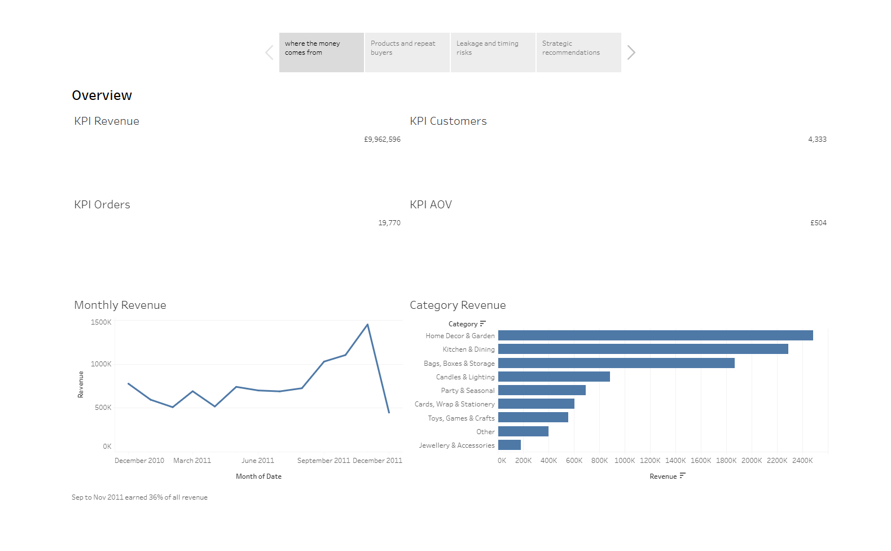
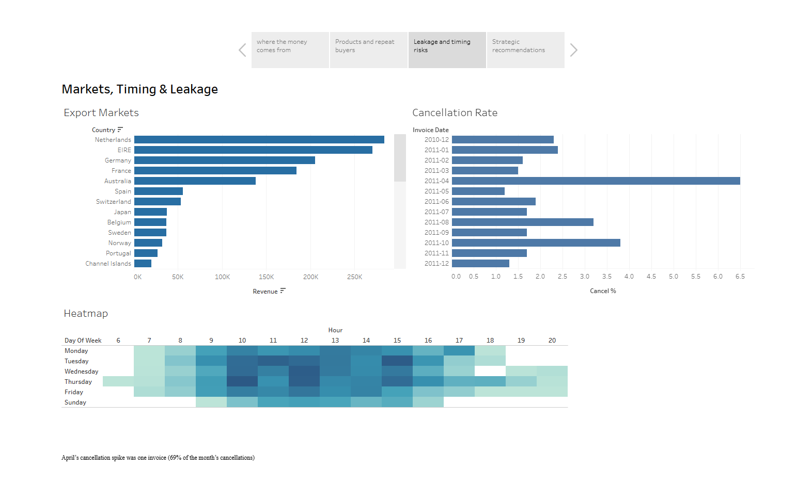
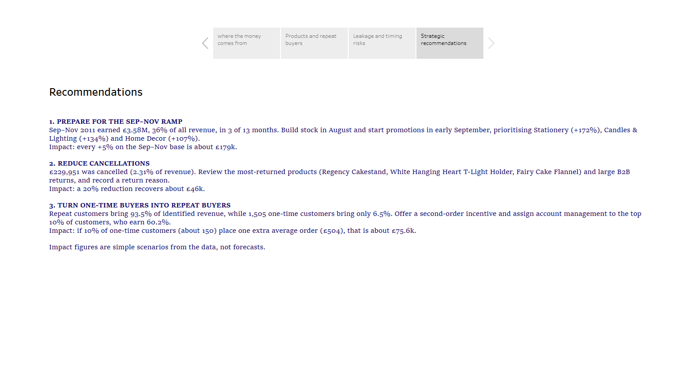

# Business Sales Performance Analytics: Online Retail (Dec 2010 – Dec 2011)

**Future Interns · Data Science & Analytics · Task 1**
Intern: Viniska K S · CIN: FIT/OCT26/DS23848

> 📊 **Live dashboard (Tableau Public):** https://public.tableau.com/app/profile/viniska.k.s/viz/Online_Retail_17924908396200/Story1?publish=yes

---

## 1. Business problem
A UK-based online gift retailer sells to wholesale and retail customers in 38 countries. This project answers the questions a business owner would ask:

1. Which products generate the most revenue?
2. How do sales change over time?
3. Which categories and regions matter most?
4. Where is revenue being lost?
5. Where should the business focus to grow faster?

## 2. Data
- **Source:** [Online Retail Dataset (Kaggle)](https://www.kaggle.com/datasets/ulrikthygepedersen/online-retail-dataset)
- **Raw size:** 541,909 transaction lines, 8 columns
- **Period:** 1 Dec 2010 to 9 Dec 2011 (13 months). **December 2011 covers only 9 days**, so it is not comparable with a full month.
- **Not in the data:** product costs or profit, so all analysis is on **revenue**, not margin.

## 3. Tools
Python (pandas) in Google Colab for cleaning and analysis · Tableau Public for the dashboard · GitHub for documentation

## 4. Data cleaning log
| # | What I did | Why | Rows |
|---|---|---|---|
| 1 | Removed exact duplicate rows | Double-counted revenue | 5,268 |
| 2 | Parsed `InvoiceDate` to date-time and added Date, Month, DayOfWeek and Hour | Time analysis | all |
| 3 | Moved invoices starting with "C" to a separate **cancellations** file | Kept for leakage analysis, not deleted | 8,665 |
| 4 | Moved zero-price or non-sale negative rows (e.g. stock write-offs) to **adjustments** | They are not sales | 2,493 |
| 5 | Moved postage, fees, bank charges, gift vouchers and manual entries to **fees** | Not products | 2,940 |
| 6 | Isolated **3 phantom orders** (an order over £5,000 fully cancelled by the same customer within minutes) | They would overstate revenue by £284,623 (2.9%) and create a fake #2 product | 6 |
| 7 | Kept rows with no CustomerID for revenue analysis, excluded them from customer analysis | £1.51M (15.2%) of revenue has no customer ID | 131k lines |
| 8 | Created `Revenue = Quantity × UnitPrice` | Core metric | all |
| 9 | Created 9 product categories by keyword matching on product descriptions, with manual fixes | The dataset has no category column | |

**Final analysis dataset:** 522,537 sales lines.
Every row is accounted for: 522,537 sales + 8,665 cancellations + 2,493 adjustments + 2,940 fees + 6 phantom = 536,641 rows after de-duplication.

⚠️ **Categories are an approximation** (keyword matching), not an official classification.

### The 3 phantom orders
| Invoice | Product | Value | Cancelled after |
|---|---|---|---|
| 541431 | Medium ceramic top storage jar (74,215 units) | £77,184 | 16 minutes |
| 556444 | Picnic basket wicker, 60 pieces (60 units at £649.50) | £38,970 | 11 minutes |
| 581483 | Paper craft, little birdie (80,995 units) | £168,470 | 12 minutes |

## 5. Key numbers
| KPI | Value |
|---|---|
| Gross revenue | **£9,962,596** |
| Cancelled value | £229,951 (2.31%) |
| Net revenue | **£9,732,645** |
| Orders | 19,770 |
| Identified customers | 4,333 |
| Average order value | £503.92 |
| Best month | Nov 2011, £1,452,116 |

## 6. Insights

1. **Q4 ramp:** Sep to Nov 2011 produced **£3.58M, 36% of all revenue** in 3 of the 13 months. The monthly average (£1.19M) is 77% above Mar to Aug (£0.68M). The strongest lifts were Stationery (+172%), Candles & Lighting (+134%) and Home Decor (+107%). This is a single year, so I describe it as a ramp, not proven seasonality.
2. **A flat product mix with one standout:** the Regency Cakestand earns £174k (1.75%). The top 10 products are only 8.1% of revenue. **257 products (6.4%) earn 50% of revenue, and 868 (21.7%) earn 80%.** The bottom half of products earns just 4.0%.
3. **Volume is not value:** WW2 Gliders sold the most units (54,951) but earned £13.8k, about £0.25 per unit.
4. **Repeat customers drive the business:** 65% of identified customers are repeat and generate **93.5%** of identified revenue. The top 10% of customers (433) earn **60.2%**. 1,505 one-time customers (35%) bring just 6.5%.
5. **The UK is 84.7% of revenue.** Exports are concentrated: Netherlands £284k from 9 identified customers (about £3,050 per order) and EIRE £271k from 3 identified customers. Germany and France are broader markets (94 and 87 customers, about £465 to £480 per order).
6. **Cancellations:** 2.31% of value overall. **April's spike (6.5%) is one invoice**, C550456, worth £22,998 and 69% of April's cancellations. Without it April is 2.0%. October (3.8%) is a spread of smaller returns.
7. **When customers buy:** 75% of revenue happens between 10:00 and 16:00. Thursday is the strongest day (£2.13M), and **there are no Saturday sales at all**. Sunday is the weakest trading day (£798k).
8. **Data quality:** 15% of revenue (£1.51M) cannot be tied to a customer, and 3 phantom orders were found and removed.

## 7. Recommendations

| # | Recommendation | Evidence | Estimated impact (assumption stated) |
|---|---|---|---|
| 1 | **Prepare for the Sep to Nov ramp.** Build stock in August and start promotions in early September, prioritising Stationery, Candles & Lighting and Home Decor. | 36% of revenue came in Sep to Nov; those three categories lifted 107 to 172% | Every **+5% on the Sep to Nov base is about £179k** (5% × £3.58M) |
| 2 | **Reduce cancellations.** Review high-return products and large B2B returns, and record a return reason, because the data has none. | £229,951 cancelled; top returned: Regency Cakestand (£9.7k), White Hanging Heart T-Light Holder (£6.6k) and Fairy Cake Flannel (£6.6k) | A **20% reduction recovers about £46k** (20% × £229,951) |
| 3 | **Convert one-time buyers into repeat buyers and protect top accounts.** Offer a second-order incentive and assign account management to the top 10% of customers. | Repeat customers earn 93.5% of identified revenue; one-time customers 6.5% | If 10% of one-time customers (about 150) place **one extra average order (£504), that is about £75.6k** |

*Impact figures are simple scenarios built from the data, not forecasts.*

## 8. Dashboard

### Overview


### Products and customers


### Markets, timing and leakage


### Recommendations


## 9. Repository structure
```
FUTURE_DS_01/
├── README.md
├── 01_cleaning_and_kpis.ipynb    (cleaning, categories, KPIs and analyses)
├── FUTURE_DS_01_data.zip         (cleaned datasets and KPI tables)
├── step6_tables.zip              (Pareto, customer summary, category seasonality)
└── *.png                         (dashboard screenshots)
```
**To reproduce:** download the raw data from Kaggle, open the notebook in Google Colab, upload `archive.zip`, and run the cells in order.

## 10. Limitations
- Revenue only. No cost or margin data was available.
- 13 months of data, with December 2011 incomplete, so I do not claim true seasonality.
- "One-time" customers means one order inside this window. They may have bought before December 2010.
- Customer counts by country exclude transactions with no CustomerID, so they are minimums.
- Some cancellations may refund orders placed before 1 Dec 2010, so cancellation figures are estimates.
- Categories come from keyword matching and are approximate.
